  <a href="https://www.zakaria-makhkhas.com">
    <picture>
      <source media="(prefers-color-scheme: dark)" srcset="https://raw.githubusercontent.com/mks-zakaria/mks-zakaria/main/assets/hero-dark.svg">
      <source media="(prefers-color-scheme: light)" srcset="https://raw.githubusercontent.com/mks-zakaria/mks-zakaria/main/assets/hero-light.svg">
      
    </picture>
  </a>

  
  
  
  

## Engineer, researcher, and trainer

I build and architect modern full-stack web applications and pursue machine learning
research. From low-level C to production React and Python services, I enjoy the full
range of software — and I love passing on what I learn.

- 🌱 **CTO at Agrogo** — leading technology for connected-farm platforms in production
- 🎓 **AI Trainer at OFPPT** *(part-time)* — teaching applied ML, deep learning, big data, RAG and LLM chatbots
- 🔬 **Ph.D candidate at UIT Kenitra** — multimodal machine learning across vision, language and structured data
- 📱 **Building [Noor](https://apps.apple.com/app/noor-prayer-times-qibla/id6790552873)** (iOS) and **[Snaptle](https://www.snaptle.com)** — an adaptive French-learning tutor
- 🌍 Casablanca, Morocco · English, French, German, Arabic

## Skills

| | |
|---|---|
| **Languages** | JavaScript · TypeScript · Python |
| **Frontend** | React · Next.js · Three.js |
| **Backend** | Django · Node.js · REST APIs · PostgreSQL · Redis · SQLite |
| **Data & AI** | Machine Learning · Deep Learning · Big Data · RAG · Expert Systems · LLM Chatbots |
| **Cloud & DevOps** | Docker · Kubernetes · CI/CD · GCP · Airflow · Git |
| **IoT & Embedded** | MQTT · LoRaWAN · Bivocom |

## Selected work

Most of these are **live and open to try**, not just described.

| Project | What it is | Stack |
|---|---|---|
| [**Noor — Prayer Times & Qibla**](https://apps.apple.com/app/noor-prayer-times-qibla/id6790552873) | Native iOS app: prayer times computed on-device, Qibla compass, full Quran with audio, adkar & a daily wird. EN/FR/AR, no data ever leaves the device. | Swift · SwiftUI · WidgetKit · Adhan |
| [**Snaptle**](https://www.snaptle.com) | Adaptive French-learning tutor — evaluation, adaptive practice and quizzes for French as a foreign language, with an open learner model. | Next.js · Python/FastAPI · PostgreSQL |
| **Agrilogy** | Connected-farm platform — field sensors to dashboard: device ingestion over MQTT, LoRaWAN and Bivocom gateways, shipped with Docker and CI/CD. *(client work)* | React · Next.js · Django · PostgreSQL/Redis |
| [**Plant Disease Recognition**](https://www.zakaria-makhkhas.com/plant-disease) | 38 crop diseases, 98.7% on detached leaves and a fraction of that on real field photos — the page shows both, honestly. | PlantVillage · colour CNN in pure JS |
| [**Emotion Recognition**](https://www.zakaria-makhkhas.com/emotion-recognition) | Runs entirely in your browser at 1.8 ms/frame — nothing is uploaded. One order *K* trades accuracy, compute and privacy. | Webcam · pure-JS CNN · Tchebichef moments |
| [**RAG — Moroccan Law Assistant**](https://www.zakaria-makhkhas.com/lois-maroc) | Bilingual (AR/FR) Q&A over three official codes; every answer cites the statute articles it used. | transformers.js · multilingual-e5 · Groq |

<b>Machine-learning playground</b> — a supervised → unsupervised progression, every one interactive

 

| Algorithm | What you can watch happen |
|---|---|
| [CNN Digit Recognizer](https://www.zakaria-makhkhas.com/cnn) | A CNN trained from scratch to 98% on MNIST — draw a digit and watch it predict |
| [Linear Regression](https://www.zakaria-makhkhas.com/linear-regression) | Live gradient descent on car mileage → price |
| [Logistic Regression](https://www.zakaria-makhkhas.com/logistic-regression) | Sigmoid + cross-entropy descent, live probability field |
| [Perceptron](https://www.zakaria-makhkhas.com/perceptron) | Rosenblatt's rule learning on every mistake |
| [Support Vector Machine](https://www.zakaria-makhkhas.com/svm) | Soft-margin SVM via subgradient descent |
| [K-Nearest Neighbors](https://www.zakaria-makhkhas.com/knn) | Lazy majority vote — slide *k* to reshape the regions |
| [Decision Tree](https://www.zakaria-makhkhas.com/decision-tree) | Greedy CART carving the plane by information gain |
| [Random Forest](https://www.zakaria-makhkhas.com/random-forest) | Bagged trees voting, boundary smoothing out |
| [Neural Network](https://www.zakaria-makhkhas.com/neural-net) | A 2-layer MLP bending a curved boundary via backprop |
| [K-Means Clustering](https://www.zakaria-makhkhas.com/kmeans) | Lloyd's algorithm, k-means++ seeding, live Voronoi regions |
| [Pathfinding](https://www.zakaria-makhkhas.com/pathfinding) | A* vs Dijkstra vs BFS on a grid you draw |
| [Tic-Tac-Toe AI](https://www.zakaria-makhkhas.com/tic-tac-toe) | Minimax + alpha-beta — try to beat it |
| [Bubble Sort](https://www.zakaria-makhkhas.com/bubble-sort) | Adjacent comparisons and swaps, pass by pass, with early exit |

<b>Systems &amp; 42 School</b> — C, concurrency, networking and infrastructure

 

| Project | Stack |
|---|---|
| [Transcendence](https://github.com/mks-zakaria/Transcendance) | React · NestJS · PostgreSQL · Docker · Django |
| [Dockerized Infrastructure](https://github.com/mks-zakaria/42-Inception) | Docker · NGINX · WordPress · MariaDB · Redis |
| [HTTP Web Server](https://github.com/mks-zakaria/42-webserv) | C++ · Makefile · Python · PHP |
| [Minishell](https://www.zakaria-makhkhas.com/minishell) | C · parsing — live tokenizer & AST visualizer |
| [Fract-ol](https://www.zakaria-makhkhas.com/fractol) | C · WebGL · GLSL — live in-browser explorer |
| [Cub3D](https://www.zakaria-makhkhas.com/cub3d) | C · raycasting — playable in-browser engine |
| [Push-swap](https://www.zakaria-makhkhas.com/push-swap) | C · algorithms — live sorting visualizer |
| [Philosophers](https://www.zakaria-makhkhas.com/philosophers) | C · threads · concurrency — live simulator |
| [Pong 3D](https://www.zakaria-makhkhas.com/pong) | Three.js · WebGL — playable 3D Pong |

## Experience

| | Role | Where |
|---|---|---|
| **Apr 2026 — Present** | Chief Technology Officer | Agrogo |
| **May 2026 — Present** | AI Trainer *(Formateur en IA, part-time)* | OFPPT, Morocco |
| **Sept 2025 — May 2026** | Full-Stack Engineer | Revly |
| **2023 — Sept 2025** | Software Developer *(Freelance)* | Agrilogy |
| **Sept 2022 — May 2026** | Math & Informatics Teacher | Ministry of National Education, Morocco |

<b>What that work looked like</b>

 

- **Agrogo (CTO)** — leading technology, full-stack engineering and data science for connected-farm platforms: React, Next.js, Django and Python data pipelines on PostgreSQL and Redis, device ingestion over MQTT, LoRaWAN and Bivocom gateways, deployed with Docker and CI/CD.
- **OFPPT** — part-time training learners in applied AI (machine learning, deep learning, big data, expert systems, RAG and LLM-powered chatbots) through project- and competency-based pedagogy.
- **Revly** — full-stack features with Next.js, React and PostgreSQL; data pipelines and Airflow DAGs on GCP / GCS, plus LLM-powered chatbots, shipped with Docker.
- **Agrilogy (freelance)** — full-stack agri-IoT platforms with React, Next.js and Django; device-ingestion pipelines over MQTT, LoRaWAN and Bivocom gateways, backed by PostgreSQL and Redis, deployed with Docker and CI/CD.
- **Ministry of National Education** — taught mathematics and computer science in higher and primary education, with differentiated, project-based pedagogy focused on soft skills.

## Education

| | Qualification | Where |
|---|---|---|
| **2024 — Present** | Ph.D — multimodal machine learning | UIT Kenitra, Morocco |
| **2022 — Present** | RNCP7 — AI & Data Architecture *(Bac+5)* | 1337 Khouribga / 42 Network |
| **2020 — 2022** | Master's Degree — secure systems & applied AI | ENSIAS, Rabat, Morocco |

## Research

Peer-reviewed publications — with A. Rifai and A. Sadiq.

- **Multimodal Large Language Models versus Task-Specific Models for Ordinal Student Attention Recognition** — *ICAIS 2026*, Springer LNCS · FSBM Casablanca, 28–30 Oct 2026 · code: [dipser-ordinal-attention-benchmark](https://github.com/mks-zakaria/dipser-ordinal-attention-benchmark), [dipser-vlm-poc](https://github.com/mks-zakaria/dipser-vlm-poc)
- **Tchebichef-Moment Order and the Compression–Accuracy Trade-off in Facial Pose Classification** — *ICCT 2026*, Springer LNNS

## GitHub

  <picture>
    <source media="(prefers-color-scheme: dark)" srcset="https://raw.githubusercontent.com/mks-zakaria/mks-zakaria/main/assets/stats-dark.svg">
    <source media="(prefers-color-scheme: light)" srcset="https://raw.githubusercontent.com/mks-zakaria/mks-zakaria/main/assets/stats-light.svg">
    
  </picture>

## Let's work together

Have a project in mind or just want to say hi? My inbox is always open.

**[zakaria-makhkhas.com](https://www.zakaria-makhkhas.com)** · [makhkhas.zakaria@gmail.com](mailto:makhkhas.zakaria@gmail.com) · [WhatsApp](https://wa.me/212613145086) · [LinkedIn](https://www.linkedin.com/in/zakaria-makhkhas-a999a030b/)
